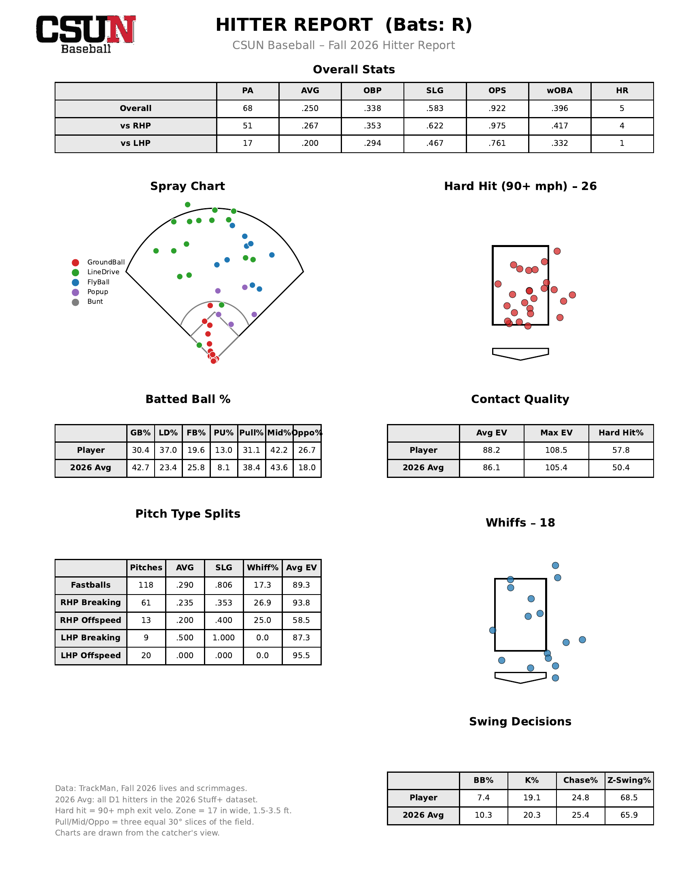

# Hitter Reports

Cumulative one-page reports for every hitter from fall lives and scrimmages, with batted-ball quality and swing decisions compared with the 2026 D1 average.



Each page shows:
- **Overall Stats:** PA, AVG, OBP, SLG, OPS, wOBA and HR, overall and vs RHP / LHP
- **Spray Chart, Hard Hit and Whiff locations**
- **Batted Ball %** and **Contact Quality:** GB / LD / FB / PU, pull / middle / oppo, exit velocity and hard-hit rate
- **Pitch Type Splits:** fastballs, plus breaking and offspeed pitches from each hand
- **Swing Decisions:** BB%, K%, chase rate and in-zone swing rate

Switch hitters get a separate page for each side of the plate.

## How to run

Put these in the same folder as the script:
- `Fall Lives/`: the TrackMan CSVs to include
- `FinalStuffPlusDataset.csv`: 2026 D1 pitch data, used for the league averages

Then run:

```
python hitter_report.py
```

This writes `CSUN_Fall_Hitter_Reports.pdf`, one page per hitter, with the most plate appearances first. In Colab, upload the files to the session first, then run the script in a cell.

**Requires:** pandas, numpy, matplotlib, Pillow

*Player names in this public version have been replaced with placeholders. No team data is included.*
